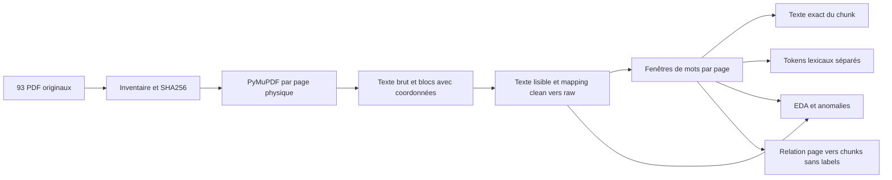

# Corpus, prétraitement et découpage — phase 1

## Reproduction

Depuis la racine profonde du projet, utiliser seulement le Python du venv :

```powershell
& .venv\Scripts\python.exe -m pip install -r requirements-phase1.lock.txt
& .venv\Scripts\python.exe -m pip install --no-build-isolation --no-deps -e .
& .venv\Scripts\python.exe scripts/ingest.py
& .venv\Scripts\python.exe scripts/eda.py
& .venv\Scripts\python.exe scripts/render_source_checks.py
& .venv\Scripts\python.exe scripts/verify_phase1.py --rebuild --eda-rebuild
& .venv\Scripts\python.exe -m pytest -q
```

Le lock comprend les outils phase 0 et les dépendances effectives phase 1.
Les commandes n'installent aucun modèle, base de données ou service réseau.
Une installation initiale des paquets nécessite PyPI; ensuite les traitements
et tests fonctionnent hors ligne.



## Sources et identité

Les PDF restent dans `utils/TxtExtraction/TextsData`. Le manifeste fourni est
contrôlé à chaque exécution : inventaire exact, SHA256, noms uniques, chemins
sous la racine, types et dates cohérents. `document_id` dépend du nom et SHA;
`page_id` est `<nom.pdf>#p<N>`, page physique 1-indexée. Une page de couverture
reste page 1 même si le numéro imprimé du document diffère.

`meeting_date` désigne la date **de fin de réunion extraite du nom de fichier**,
pas la date de publication des Minutes. `meeting_date_basis` documente cette
convention; les dates de début ne sont pas inférées. Le type `statement` du
manifeste est normalisé en `statements` selon le contrat du kit; sa valeur
initiale reste dans `source_manifest_document_type`.

## Vues et offsets

- `raw_text` : sortie PyMuPDF `get_text('text', sort=False)`, ordre natif du PDF.
  Cet ordre préserve les colonnes sur l'échantillon 2021; une note de bas de
  colonne peut néanmoins interrompre le flux. Aucun OCR ni ordre de lecture
  sémantique garanti; `blocks` garde les boîtes en points PDF pour diagnostic.
- `text` : espaces Unicode, sauts de ligne et tabulations réunis en un espace,
  marges supprimées. Césure discrétionnaire U+00AD retirée, avec son saut de ligne
  éventuel. Les caractères de contrôle non textuels sont rendus par U+FFFD et
  signalés. Pas de changement des chiffres, négations, casse ou ponctuation.
- Césure visible `-` en fin de ligne : saut de ligne retiré, trait conservé.
  `market-\nbased` devient `market-based`; `infla-\ntion` devient `infla-tion`.
  Le second exemple reste une limite lexicale documentée. L'option `join`
  supprime le trait, mais peut dégrader un vrai composé; ce n'est pas le défaut.
  Chaque modification de césure est journalisée par offsets dans le brut.
- Aucune suppression d'en-tête, note, liste, couverture, répétition ou page
  jugée peu utile. Les règles décoratives et glyphes privés sont diagnostiqués,
  pas éliminés. Aucun ajout de texte deviné.
- `bm25_tokens` : extraction regex Unicode après casefold. Décimales, signes,
  pourcentages, dates, fractions, contractions et composés conservés autant que
  le permet cette tokenisation. Aucun stemming, stopword ou lemme supprimé.
  Le texte lisible reste destiné au Dense, reranker et générateur futurs.

Les offsets `char_start,char_end` sont des indices de **caractères Unicode
Python** `[début,fin)` dans `pages.text`, pas des octets, ni des tokens de modèle.
`raw_char_start,raw_char_end` bornent le passage source dans `raw_text`;
`raw_offset_runs` encode le mapping caractère par caractère sous forme de
segments linéaires. Les blocs gardent séparément les coordonnées PDF. Une
preuve future pourra être retrouvée dans la bonne page et projetée entre vues.

## Chunking

Un mot de segmentation est une séquence non blanche (`\S+`), unité distincte
des tokens lexicaux et des wordpieces d'un modèle neural. Pour une page de
N mots, fenêtres de W mots et stride `W-overlap`, avec arrêt dès la dernière
fenêtre atteignant N. Les bornes reprennent les occurrences exactes du texte
lisible; chaque mot est couvert au moins une fois. Aucun mélange interpage
ou interdocument. Les espaces de bord ne constituent pas une perte de mots.

Baseline préenregistré : W=256, overlap=40. Configurations 128 et 512 exportées
avec le même overlap. Aucun score ni question test n'intervient dans ce choix.
Les petits fragments, couvertures et fins de page restent présents et signalés.
Le padding, la fusion entre pages et la suppression de fragments sont exclus
du baseline. Les limites de contexte des modèles devront être vérifiées en
phase 3 : 256 mots ne garantissent pas une limite de 256 wordpieces.

`chunk_id` est SHA256 de l'identité source, page, offsets, texte de page,
configuration et corpus_version. `chunking_version` décrit W/overlap/algorithme;
`index_version` lie corpus et configuration lexicale/chunking, sans construire
d'index de recherche à ce stade. La même configuration complète produit les
mêmes IDs et octets. Les fingerprints incluent aussi versions et hashes du code;
une mise à jour du logiciel invalide donc prudemment les caches.

## Exports et validité

`data/processed/` est ignoré par Git et régénérable : `documents.jsonl`,
`pages.jsonl`, `chunks_128/256/512.jsonl`, `page_chunk_map_128/256/512.jsonl`,
`extraction_issues.jsonl`, configuration et manifestes. Les maps sont de simples
relations structurelles : **aucun grade ni question**. L'alignement des extraits
de référence et les annotations par chunk restent phase 2.

`manifest.json` est le marqueur d'une exécution complète et contient les hashes
des neuf exports. `run.json` sépare durées et environnement non déterministes.
Chaque relance recalcule l'ensemble; aucun cache implicitement réutilisé. En
cas d'erreur, le marqueur est retiré et `failure.json` décrit l'échec; des
exports antérieurs/partiels peuvent rester sur disque et ne doivent pas être
consommés sans un manifeste valide. Ne pas lancer deux ingestions simultanées
vers le même dossier. Le chemin de sortie est restreint à data/processed ou
artifacts afin de protéger corpus, scripts et annotations.

L'EDA vérifie les hashes d'entrée, écrit tables CSV UTF-8, summary JSON et PNG
dans `reports/eda` et `reports/figures`. Ses doublons proches sont des paires
ayant un Jaccard ≥0,8 sur ensembles de 5-grammes lexicaux; il s'agit d'un
diagnostic lexical, pas d'une équivalence sémantique. La fréquence de mots
sans stopwords concerne exclusivement un tableau descriptif EDA; la liste
est publiée et n'est jamais appliquée aux entrées BM25.
